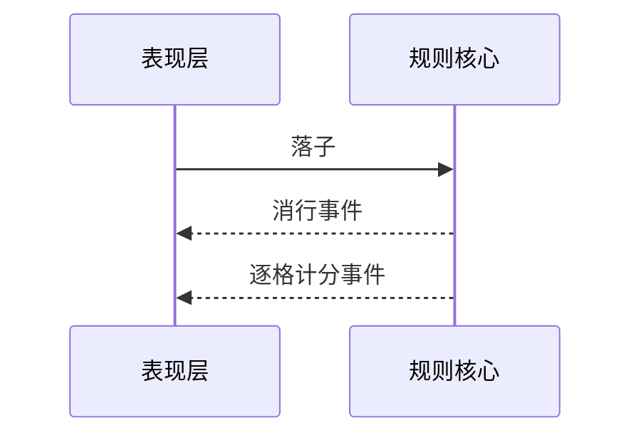

# show-me — 图解当前议题

> 改编自 humanlayer/skills 的 `show-me`(MIT,https://github.com/humanlayer/skills)。

省掉铺垫,文字只留支撑图的一两句。挑能说清要点的**最小视图**;一次可用一种或几种,不全用。

## 形态对照

| 要说清的是 | 用 |
|---|---|
| 逻辑 / 算法 | 伪代码 |
| 运行时控制流 | 调用树 |
| UI 结构,含状态与模块边界 | 组件树 / prefab 节点树 |
| 文件职责 / 大范围重构 | 浅文件树 |
| 组件交互 / 数据流,含规则核心与表现层的事件往返 | Mermaid |
| 改了什么,且周边形态已存在 | diff 形态的树 |
| 版面 / 状态对比 / Mermaid 装不下的密度 | 一个聚焦的 HTML 文件 |

## 各形态的样子

伪代码:

```text
on(保存)
  内容未变 → 返回缓存结果
  写入新内容
  返回新结果
```

调用树:

```text
打开窗口
  加载 prefab
    绑定字段
  刷新数据
```

组件树,带状态与归属:

```text
MainWindow (窗类文件路径)
├── m_btn_Mask          # 弹窗层遮罩
└── m_scroll_List
    └── ItemPart        # 手写 Part 类
```

浅文件树:

```text
src/
├── ui/        # 窗与 Part
├── rules/     # 纯 C# 规则核心
└── config/    # Luban 生成物
```

Mermaid:



diff 形态的树,只标改动:

```diff
 MainWindow
   m_btn_Mask
+  m_btn_Claim
   ItemPart
+    m_text_Count
```

整块代码:大部分是新的、省略会丢掉归属或顺序、或用户需要可复制的目标形态时,给整块而不是 diff。

HTML 文件:写到 scratchpad,文件名 `show-me-<描述>.html`;配色、字号、标签用产品实际值,桌面与手机都可看。出口按当前 harness 可用工具选:SendUserFile(`display=render`)渲染本地文件,`show_widget` 内联小图(先调其 `read_me`),Artifact 发布可分享页。

## 指引

- 每个图挨着它支撑的那句话。
- 只留回答当前问题所需的调用、文件、字段、状态与边界。
- 图里对现状的断言附可 grep 的锚点,口径同 devflow-explore 卡「姿态」。

## 本卡不做

只做呈现。不改仓内文件、不写产品代码;图解中冒出的改动意愿记为候选任务,走 devflow。
