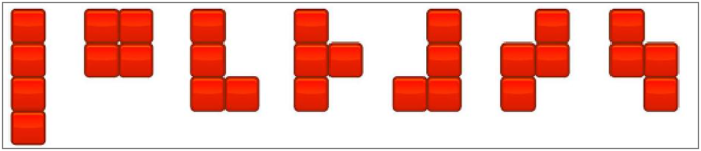
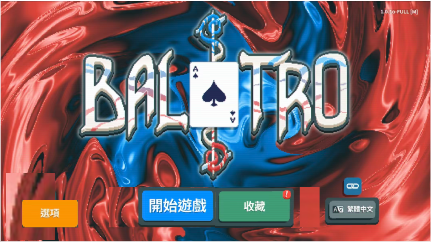
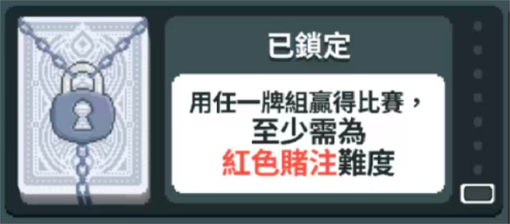
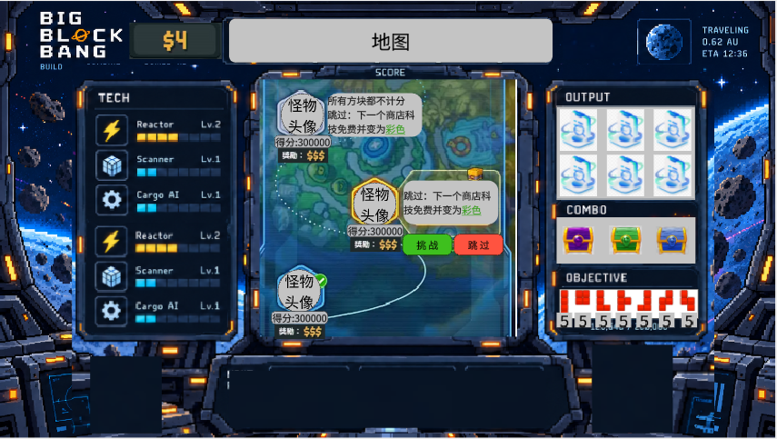
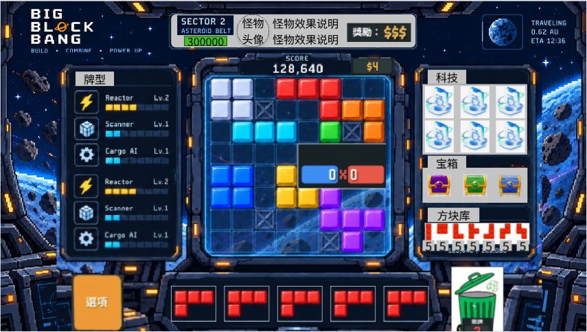
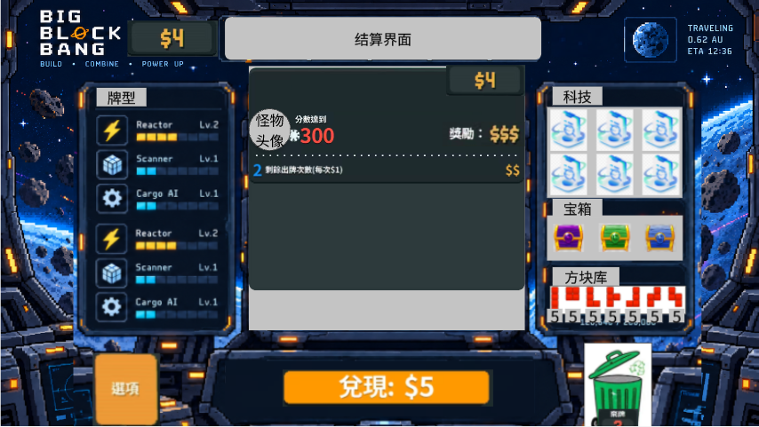
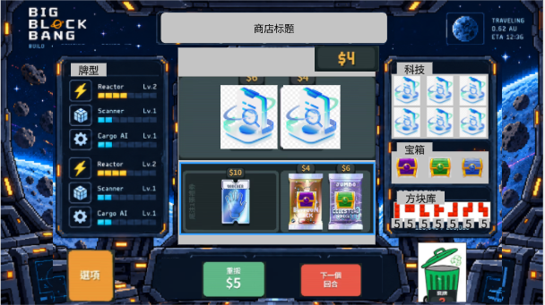

# 《代号：3B（Black Block）》核心游戏规则设计文档

> 黑块方块消除 × Balatro 肉鸽构筑融合设计

<!-- 2026-10-22 由 原件/3B核心游戏规则设计文档.docx 逐字转写（正文文字与原件一致，只改了排版）。
     原件冻结不再回写，此后的修改都在这份 md 里做。
     2026-10-22 按 3B审计裁定.md 修订了 §1.2、§2、§3、§4 各节导语、§4.4、§5、§6、§7、§8；
     三张清单（§4.1.1、§4.2.1、§4.3.1）待重新长，表内正文没动。
     2026-10-27 按「3B 首个可玩盲注」地图的切片边界票补了 §2.2、§2.4、§8.5 三处空白；数据模型票补了 §2.1、§3.3 两句；结算管线票补了 §3.1 逐格的先后与重触发，改了 §2.4、§3.2 各一句。
     2026-10-28 乘区改成 Balatro 式（×倍率当场乘进倍率）：重写 §3.1 公式与先后、§3.2 整节，改了 §4.1 一句与 §4.1.1 表注；§4 加了指向 效果系统.md 的导语。 -->

> 2026-10-22 起按 [3B审计裁定.md](3B审计裁定.md) 修订，每条改动的来由见那份记录。
> 三张清单待从方块原生维度重新长，现表只作参考。

## 1 游戏概述

### 1.1 游戏定位

《代号：3B（Black Block）》是一款将 Black Block 方块消除拼图与小丑牌（Balatro）肉鸽构筑玩法深度融合的游戏。游戏以方块网格放置与消除为战斗本体，以“基因—科技—改造”构筑系统为策略核心，让玩家在每一次消除与每一次构筑取舍之间获得沉浸式的策略体验。

### 1.2 一句话玩法

玩家在 8×8 网格中放置方块，填满整行或整列时触发消除并获得分数；通过构筑基因、科技、改造等组件强化得分能力，在本盲注的方块库抽完之前、网格被填满之前，达到盲注设定的目标分数。

### 1.3 核心设计理念

- 战斗本体是 Black Block：空间管理、消除布局、收益与风险并行
- 策略深度来自 Balatro：底层规则改写、乘区叠加、流派构筑、取舍抉择
- 每个强效果绑定代价

## 2 核心玩法循环

### 2.1 基础资源

战斗在 8×8 的方形网格上进行，网格是放置方块、触发消除的唯一空间。

- **方块形状**：七种四格骨牌 I、O、T、S、Z、J、L，每块 4 格（见下图）。
- **方块的属性**：每块有一个点数，同时就是它的基础值（范围待定标）；还可以带一个强化（§4.4）和一个版本（闪箔 / 镭射 / 多彩）。这些属性都挂在**块**上，跟着这块走。不设花色，也没有人头牌。
- **方块库**：本局拥有的全部方块，是有限牌组（§5）。每个盲注开始时整库洗回、洗匀。**方块库就是这个盲注的预算**，抽完就没有了。
  消除只清掉网格上的格，不损伤方块：上一个盲注里放下的、被消掉的、弃掉的块，下一个盲注都整块回来。
- **待放置区**：一次从方块库抽一组，默认 3 块，最多可扩到 5 块。
- **弃置**：每个盲注有固定次数（次数待定标）。
- **旋转**：随时免费，不限次数。

### 2.2 盲注内的操作流程

「回合」就指一个盲注。清单里把一组方块叫作「回合」的写法，统一改称「一组」。

- 盲注开始：网格清空（首领可以带预置块），方块库整库洗回。
- 从方块库抽一组方块，放进待放置区。库里剩的不足一组时，剩几块抽几块。
- 从这一组里任选一块，可随时旋转，放到网格空位上。
- 放下后若填满整行或整列，触发一次消除，**当场结算**（§3）。一次放置同时填满的所有行列，算同一次消除。
- 这一组全部放完或弃掉之后，才抽下一组。
- 弃置：一次弃 1 块，弃掉的块不补，这一组就少一块。弃掉的块也算花掉的预算。
- 连击：连续几次放置都触发了消除就累计连击，有一次放置没有消除就清零，没有其他惩罚。连击和「多线同消」（一次放置完成 2 条以上的线）是两回事，分开命名。
  连击数含本次：一次放置触发了消除，先把连击数加 1 再结算这次消除。弃置不是放置，不改变连击。每个盲注开始时归零。

### 2.3 关卡结构

一局是一张分层地图，地图上的每个节点是一个盲注。

- 每层从相邻的 1～3 个节点里选一个往前走。
- 每段 3 层：前两层是普通盲注，第 3 层是首领盲注。打过首领才进入下一段，目标分按段上涨。一局有几段待定标。
- 普通节点可以跳过：不打这个盲注、不拿通关奖励、不进商店，换一个标签（标签清单待做）。首领不能跳过。
- 每次通关后进入商店（§2.5）。
- 开局选难度，共 3 种，每档改什么待定标。

> 地图节点、通关奖励、商店结构、难度与元进程的展开见 [局外循环.md](局外循环.md)（设计稿，待拍板）。

### 2.4 胜利与失败条件

- 盲注胜利：累计得分达到目标分，本盲注立即结束，不再抽下一组；没用完的方块不给奖励。判胜在一次放置结算完、得分入账之后，逐格计分的中途不判。
- 盲注失败，本局直接结束（肉鸽重开）。失败有两种：
  - 方块库抽完、最后一组也放完或弃完了（方块库和待放置区都空了），仍未达到目标分；
  - 当前这组剩下的块怎么转都放不下，而且弃置次数已经用完。
- 同一次放置既让累计得分达到目标分、又满足失败条件时，算胜利：达标即结束，不再判失败。
- 整局胜利：打过最后一段的首领。

### 2.5 经济与商店

- 金钱来源：盲注通关奖励和利息，没有「剩余次数奖励」。奖励额、利息比例和上限待定标。
- 商店出售：基因、科技、改造、补给包、优惠券、方块。方块直接加进方块库，也就是加预算。刷新费待定标。
- 传说基因不进商店，只在基因补给包里以极低概率出现。
- 优惠券永久改底层参数，也是扩容手段之一：基因槽、道具栏、每组块数都能靠它扩。
- 消耗品（科技、改造）放在道具栏，默认 2 格，最多 3 格。名字不带「方块」后缀，不和能放进网格的方块撞名。

## 3 基础得分体系

### 3.1 计分公式

游戏的得分与小丑牌的计分逻辑同构：底分、倍率两个累加器，每次消除当场结算一次，结算完相乘一次。公式如下：

得分 = 底分 × 倍率

- 底分从消除类型的底注起，加上被消各格的点数和各类 +底分。
- 倍率从消除类型的基础倍率起，按结算顺序：+倍率加进去，×倍率**当场乘进去**。
- 消除类型按 §3.3 判定。一次消除同时满足几种类型时，只取优先级最高的一种。
- 被消各格的点数：每被消 1 格，计一次它所属那块的点数；行列交叉的那一格只算一次。一块方块可能分几次被消，每次只计这次被消的格。
- 结算顺序：先定消除类型；再逐格计分；最后按基因槽从左到右结算基因，基因可以拖动换位。全部结算完，底分乘倍率一次，得数向下取整；一次消除的得分不为负。
- 逐格的先后按线走：先走被消的行，从上到下，每行从左到右；再走被消的列，从左到右，每列从上到下。行列交叉的格归它所在的行，走到列上时跳过。「首个被消的格」就是这个顺序里的第一格。
- 每一格依次：计一次所属块的点数，触发一次所属块的强化和版本，再轮到对单格起作用的基因（从左到右）。
- 重触发让一格把上面这一整段原样再走一遍，紧接着走，走完才到下一格。它只作用于逐格计分，不会让定类型或基因结算再来一次。
- **先后决定得分**：×倍率只放大它生效之前已经进到倍率里的部分。基础倍率 5，一个 +10 倍率、一个 ×2：+10 在前得 (5 + 10) × 2 = 30，×2 在前得 5 × 2 + 10 = 20。
  - 基因的左右位置因此是硬机制：+倍率的放左边，×倍率的放右边。
  - 逐格段在基因段之前：块上的 ×倍率（琉璃、多彩）只放大基础倍率和排在它前面的加成，基因段的 ×倍率放大全部逐格加成。
  - 一个来源同时给几项时，先 +底分、+倍率，后 ×倍率。带版本的基因：加算的版本在基因本体之前，×倍率的版本在本体之后。
  - 底分只做加法，各项先后不影响底分。
  - 同 Balatro 1.0.1o，见 [出牌结算管线.md](../../参考/结论/Balatro_1.0.1o/出牌结算管线.md) §0、§4.2、§6。2026-10-28 由「三区各自累加、最后相乘」改来，来由见 [效果系统.md](效果系统.md) §1。
- 倍率可以带小数：保留到 0.001，每次乘完向下取整到 0.001。×倍率乘之前，倍率低于 0 的先按 0 算。

### 3.2 两个累加器与三种加成

| 加成 | 进哪个累加器 | 怎么算 | 说明 |
|---|---|---|---|
| +底分 | 底分 | 相加 | 消除类型底注、被消各格点数、各类加算分值，决定单次消除的基础分数 |
| +倍率 | 倍率 | 相加 | 基础倍率、各类加算倍率 |
| ×倍率 | 倍率 | 当场相乘 | 只放大已经进到倍率里的部分。最强爆发手段，是高分局构筑的核心 |

底分与倍率最后相乘一次。玩家既要区分三种加成，也要排它们的先后：加算先堆满，×倍率排在后面才放大得多。这是构筑策略的核心。

### 3.3 方块形状与消除类型

方块形状是放置的素材：七种四格骨牌，见 §2.1。

消除类型是一次消除的结果，决定底注与基础倍率。越难达成的类型，底注与倍率越高；数值待按网格难度定标（§4.2）。

判定只看三样东西：
- 这次放置完成的行数 r、列数 c，线数 L = r + c。四格骨牌一次最多完成 5 条线。
- **同形态**：这次被消的格，全部来自同一种形状的方块。比的是七种骨牌的种类：朝向不算（横放、竖放的 I 是同一种），镜像算两种（S 与 Z、J 与 L 不同）。
- **清屏**：消除之后，网格里除死格以外没有方块。

共 11 种。一次消除同时满足几种时，从上往下取第一个满足的：

| 优先级 | 类型 | 判定 | 对应科技 |
|--:|---|---|---|
| 1 | 清屏 | 消除后网格里除死格外没有方块 | 湮域 |
| 2 | 五线 | L = 5 | 五契 |
| 3 | 同形态十字 | 同形态，且 r ≥ 1、c ≥ 1 | 同枢 |
| 4 | 多线 | L = 4 | 多楔 |
| 5 | 同形态 | 同形态 | 同构 |
| 6 | 三线 | L = 3 | 三棱 |
| 7 | 拐角 | r = 1、c = 1，交点在网格四角之一 | 矢列 |
| 8 | 十字 | r ≥ 1、c ≥ 1 | 枢衡 |
| 9 | 平行线 | ≥ 2 条相邻的行，或 ≥ 2 条相邻的列 | 折轨 |
| 10 | 双线 | L = 2 | 双轨 |
| 11 | 单线 | L = 1 | 单轴 |

按这个顺序，十字、平行线、双线实际只覆盖 L = 2 的三种摆法：一行一列（交点不在角上）、两条相邻平行线、两条不相邻平行线。

- 判定与优先级是 2026-10-22 的起草稿，定标时用模拟出的出现频率重排。
- 相对原表的改动：
  - 「全清屏（同形态五线型）」删除。
  - 「连续直线 ≥5 格」在 8×8 上恒成立，改成平行线。
  - 「拐角双线」写不出判定，改成拐角。
  - 湮域原写「清屏（同形态连续直线型）」，改成只看清屏。

死格（不可消除、不可放置的格）在判定里算空洞，所在行列凑不满。「永久」类效果只管到本盲注结束，下一个盲注重新开盘。

## 4 核心构筑系统

> 基因、科技、改造、强化、版本这些效果挂在哪、什么时候结算、能改什么，统一见 [效果系统.md](效果系统.md)。

### 4.1 基因（对标小丑牌）

基因是游戏的核心构筑组件，为本局永久生效的被动能力，可通过商店购买、出售、更换。

- **出售**：随时可卖，盲注进行中也能卖（同 Balatro）。2026-10-30 定，摔跤、卖焰这类「卖出时」生效的基因靠这一条。
- **槽位**：基因槽默认 4 个，最多 6 个。扩槽靠优惠券、负片版本和少数基因的效果。
- **结算顺序**：按槽位从左到右结算，可以拖动换位；位置决定 ×倍率放大哪些加成（§3.1）。
- **稀有度**：分普通、罕见、稀有、传说四档。传说基因不进商店，只在基因补给包里以极低概率出现。
- **版本**：闪箔、镭射、多彩，以及只有基因能带的负片（带负片的基因不占槽）。原来「镀金：正面效果与负面代价同时翻倍」的设定取消。
- **代价**：按强度配。强效果必须绑定真实负面，弱效果可以没有；「需要满足触发条件」不算代价。代价写成「本盲注目标分 +X%」时，只作用于拿到该基因之后的第一个盲注。

#### 4.1.1 基因全清单（150 个，对应原小丑牌）

> **本表待重新长**：三张清单要从方块原生维度（形状、点数、位置、连击、空间）重新长出来，只保留合得上的原作条目。
> 2026-10-29 重长、2026-10-30 扩到 150 张的初稿见 [基因清单.md](基因清单.md)，待拍板后替换本表。
>
> 下表是起点文档的逐条转写，只作参考，不再逐条修。表里的弃置、储备库、L 拐角 / 冠饰 / 三叶、花色、序数、「回合」、「独立乘区 / 独立倍率放大」（即 ×倍率，§3.2）等写法，一律以正文为准。
>
> 「原小丑名称」列保留，作内部对照。重新长时，成长型倍率一律写成「从 ×1 起，每次 +×0.x」。

| 序号 | 3B基因名称 | 原小丑名称 | 稀有度 | 价格($) | 3B基因效果 | 代价/负面 | 流派标签 |
|---|---|---|---|---|---|---|---|
| 1 | 溢生基因 | 八号球 | 普通 | 5 | 每回合第 8 次放置方块并参与消除结算时，1/4 概率生成 1 枚随机「特殊方块」（一次性道具）。 | 无直接负面；为凑“第 8 次放置”常需牺牲最优消除线（节奏机会成本）。 | 空间流 |
| 2 | 虚影基因 | 抽象小丑 | 普通 | 4 | 每额外携带 1 个其他基因，本基因提供 +3 倍率（加算倍率区）。 | 收益依赖基因槽位堆叠，本基因自身也占用 1 槽，满员 6 槽时天花板自然受限。 | 构筑流 |
| 3 | 悬帜基因 | 旗帜 | 普通 | 5 | 消除结算时，本回合每剩余 1 次未使用的弃置机会，底分 +30。 | 为留存弃置次数而被迫提前落子，常错过更优的成线时机（节奏牵制）。 | 基础流 |
| 4 | 淀蓝基因 | 蓝色小丑 | 普通 | 5 | 消除结算时，方块储备库中每剩余 1 块未补充的方块，底分 +2。 | 库中余量越多、手牌区越稀薄，落子选择被迫收窄（机会成本）。 | 基础流 |
| 5 | 名帖基因 | 名片 | 普通 | 4 | 每消除 1 块「L 拐角块」（冠饰块），消除结算时 1/2 概率获得 $2。 | 收益绑定特定拐角形状，构筑必须为它留出冠饰块的位置（形状依赖）。 | 经济流 |
| 6 | 蚀灭基因 | 卡文迪什 | 普通 | 4 | 消除结算时，基础倍率 ×3 放大（独立乘区）。 | 每回合结束有 1/1000 概率基因碎裂、被永久湮灭移除。 | 爆发流 |
| 7 | 紊序基因 | 混沌小丑 | 普通 | 4 | 每次进入铸造厂（商店）期间，货架可免费刷新 1 次。 | 仅在商店生效，对局放置阶段完全空转，纯占 1 个基因槽位。 | 经济流 |
| 8 | 双捷基因 | 聪敏小丑 | 普通 | 4 | 单次放置回合内完成 2 组双线消除（2 条线与另 2 条线）时，底分 +80。 | 需刻意凑出两组双线，往往牺牲单次更长的高分行（节奏牵制）。 | 连消流 |
| 9 | 萃色基因 | 精明小丑 | 普通 | 4 | 一次消除中同形态方块（同色系）参与数量达到 3 块及以上时，底分 +80。 | 必须囤积同形方块入线，牺牲形状搭配的弹性。 | 连消流 |
| 10 | 横亘基因 | 狂野小丑 | 普通 | 4 | 单次消除形成连续直线（≥5 格连成一线贯通）时，倍率区 +12。 | 长直线需提前整行预留空位，网格调度高度紧张。 | 连消流 |
| 11 | 赊空基因 | 信用卡 | 普通 | 1 | 允许金钱透支至 -$20（正常情况下金钱下限为 0）。 | 回合结束时若仍处于负值，下次进入铸造厂时刷新费用 +$1（滚动利息）。 | 经济流 |
| 12 | 滞蓄基因 | 延迟满足 | 普通 | 4 | 本回合每未使用 1 次弃置机会，回合结束时获得 $2。 | 拒绝弃置意味着只能凭手中现有方块硬撑过关，失误率上升（节奏牵制）。 | 经济流 |
| 13 | 诡线基因 | 阴险小丑 | 普通 | 4 | 单次消除形成连续直线（≥5 格贯通）时，底分 +100。 | 整行贯通的布局周期长，期间网格被长期占位无法灵活应变。 | 连消流 |
| 14 | 谐形基因 | 滑稽小丑 | 普通 | 4 | 一次消除中有同形态方块（同色系）参与时，倍率区 +10。 | 收益依赖同形堆积，方块组合弹性被自我压缩。 | 连消流 |
| 15 | 酩酊基因 | 醉汉 | 普通 | 4 | 每回合弃置机会 +1。 | 多一次弃置极易诱发无谓弃块，打乱储备库节奏（机会成本）。 | 基础流 |
| 16 | 孵成基因 | 鸡蛋 | 普通 | 4 | 本基因每经过 1 个回合，其拆除（售卖）售价 +$3，永久累积。 | 前期占槽不提供任何战斗收益，须长期持有才回本（机会成本）。 | 经济流 |
| 17 | 偶迹基因 | 偶数史蒂文 | 普通 | 4 | 第 2、4、6、8……次放置方块并参与消除时（偶数序数落子），倍率区 +4。 | 奇数序数的落子完全不触发，半数放置空转（节奏牵制）。 | 基础流 |
| 18 | 空面基因 | 无面小丑 | 普通 | 4 | 单次一次性弃置 3 块及以上「L 拐角块」（冠饰块）时，获得 $5。 | 被弃置的冠饰块直接湮灭、不进消除线，浪费可用形状（资源消耗）。 | 经济流 |
| 19 | 卜辞基因 | 占卜师 | 普通 | 6 | 本局每使用 1 枚「改造方块」（一次性改造道具），永久 +1 倍率。 | 改造方块用于叠倍率即放弃其即时改造效果，二选一（机会成本）。 | 基础流 |
| 20 | 饕形基因 | 暴食小丑 | 普通 | 5 | 每消除 1 块「L 拐角块」（三叶块），倍率区 +3。 | 收益绑定三叶形方块入消除线，构筑形状自由度被收窄。 | 基础流 |
| 21 | 鎏金基因 | 黄金小丑 | 普通 | 6 | 每回合结束时自动获得 $4。 | 对局中不提供任何分值或倍率，纯产出金钱占 1 个基因槽（机会成本）。 | 经济流 |
| 22 | 金券基因 | 黄金门票 | 普通 | 5 | 每消除 1 块「鎏金方块」（被金色强化的方块），获得 $4。 | 鎏金方块数量稀少且需先另行强化，收益不稳定、依赖前置构筑。 | 经济流 |
| 23 | 婪方基因 | 贪婪小丑 | 普通 | 5 | 每消除 1 块「田字块」（2×2 方形块），倍率区 +3。 | 方形块占地 4 格，网格占用率高，挤压其他形状的摆放空间。 | 基础流 |
| 24 | 翠涨基因 | 绿色小丑 | 普通 | 4 | 每完成 1 次放置回合 +1 倍率；每弃置 1 块 -1 倍率，双向实时浮动。 | 弃置失误立即反噬已叠倍率，叠出的高度可随时被削回零（双向波动）。 | 基础流 |
| 25 | 脆蕉基因 | 大麦克香蕉 | 普通 | 5 | 无条件 +15 倍率（加算倍率区）。 | 每回合结束有 1/6 概率本基因碎裂、被永久湮灭移除。 | 基础流 |
| 26 | 残片基因 | 半张小丑 | 普通 | 5 | 单次消除仅由 3 块及以下的方块触发时，倍率区 +20。 | 小块消除的底分天然偏低，高分长直线被自我禁止（机会成本）。 | 基础流 |
| 27 | 妄象基因 | 幻觉 | 普通 | 4 | 每开启 1 个「补给包」，1/2 概率额外生成 1 枚随机「改造方块」。 | 仅在开启补给包时触发，对局放置与常规商店阶段完全空转（占槽机会成本）。 | 空间流 |
| 28 | 连票基因 | 未断选票 | 普通 | 4 | 每次消除中首个被消除的方块格，其分值额外重算 2 次（该格按 ×3 计分）。 | 重触发只惠及单格，整线的总体收益被相对稀释，多格长线收益不增。 | 连消流 |
| 29 | 霜融基因 | 冰淇淋 | 普通 | 5 | 底分永久 +100；此后每完成 1 次放置回合，该加算分值 -5，逐回合衰减。 | 加算随回合数单调递减，归零后本基因彻底空置（天然衰减机制）。 | 基础流 |
| 30 | 凡块基因 | 小丑 | 普通 | 2 | 无条件 +4 倍率（加算倍率区）。 | 基础加成无额外负面；仅占用 1 个基因槽位。 | 基础流 |
| 31 | 双轨基因 | 开心小丑 | 普通 | 3 | 若一次放置方块的消除结算同时触发两条直线消除（双线消除，对应原·对子），+8 倍率。 | 无直接负面；需刻意排布成双行/双列同消才能触发，牺牲单线满消的节奏（机会成本）。 | 连消流 |
| 32 | 拓界基因 | 杂耍师 | 普通 | 4 | 待放置方块区（手牌区）的手牌上限 +1。 | 无直接负面；多一块可选方块意味着储备库消耗略快（轻微节奏机会成本）。 | 空间流 |
| 33 | 绯核基因 | 色欲小丑 | 普通 | 5 | 圆核单格块（对应原·红桃）参与消除结算时，每块 +3 倍率。 | 无直接负面；只对圆核单格块生效，混入其他形状时收益落空（构筑机会成本）。 | 基础流 |
| 34 | 双环基因 | 疯狂小丑 | 普通 | 4 | 若一次放置方块的消除结算同时触发 2 组双线消除（共 4 条线，对应原·两对），+10 倍率。 | 无直接负面；需极高的排布密度才能凑齐两组双线，节奏压力大（机会成本）。 | 连消流 |
| 35 | 弃偿基因 | 邮件回扣 | 普通 | 4 | 每回合开始时随机指定一种方块格数；每弃置 1 块该格数的方块（从手牌区移入弃置堆），获得 $5。 | 无直接负面；回合间指定格数随机，无法稳定规划弃置路线（概率机会成本）。 | 经济流 |
| 36 | 乱码基因 | 印错小丑 | 普通 | 4 | 每次消除结算时，本基因随机赋予 0 至 +23 之间的加算倍率。 | 无直接负面；收益完全随机，可能为 0（概率机会成本）。 | 基础流 |
| 37 | 空谷基因 | 神秘之峰 | 普通 | 5 | 当本回合剩余弃置次数为 0 时，+15 倍率。 | 无直接负面；必须把弃置额度用尽才触发，后期失去容错（机会成本）。 | 基础流 |
| 38 | 畸数基因 | 奇数托德 | 普通 | 4 | 放置格数为奇数的方块（1 格单块 / 3 格 L 拐角块）参与消除结算时，每块 +31 分值。 | 无直接负面；只对奇数格数方块生效，偶数格方块（2 格长条 / 4 格田字块）无加成（构筑机会成本）。 | 基础流 |
| 39 | 定格基因 | 照片 | 普通 | 5 | 本回合首个被消除结算的「L 拐角块」（对应原·人头牌）×2 独立倍率放大。 | 无直接负面；每回合仅触发一次，且需先把 L 拐角块送进消除线（机会成本）。 | 爆发流 |
| 40 | 瞬爆基因 | 爆米花 | 普通 | 5 | 本基因入场时 +20 倍率；每推进一个关卡目标分回合（盲注），永久 -4 倍率。 | 无额外负面；高倍率随回合数自然衰减，过期即废（节奏代价）。 | 基础流 |
| 41 | 压底基因 | 致胜之拳 | 普通 | 5 | 将待放置方块区中格数最少的那块方块，其格数 ×2 后加算到倍率上。 | 无直接负面；手牌区最小格数往往很小，加算倍率偏低（机会成本）。 | 基础流 |
| 42 | 拒购基因 | 红牌 | 普通 | 5 | 每在补给商店（铸造厂）跳过 1 个补给包（对应原·补充包）不购买，本基因永久 +3 倍率。 | 无直接负面；拒绝补给包即放弃一次性道具收益，换成长线倍率（构筑机会成本）。 | 基础流 |
| 43 | 泊金基因 | 私人车位 | 普通 | 6 | 待放置方块区中每块「L 拐角块」（对应原·人头牌）有 1/2 概率在进入手牌区时生成 $1。 | 无直接负面；收益概率性，可能空手而归（概率机会成本）。 | 经济流 |
| 44 | 驰行基因 | 搭乘巴士 | 普通 | 6 | 每次消除结算未涉及任何「L 拐角块」（对应原·人头牌）时，本基因永久 +1 倍率。 | 无直接负面；必须刻意不用 L 拐角块消除，构筑被锁死（机会成本）。 | 基础流 |
| 45 | 麋集基因 | 乌合之众 | 普通 | 6 | 每次选择并进入新的关卡目标分（盲注）时，额外生成 2 个随机基因占位（对应原·生成 2 张小丑牌）。 | 生成的基因完全随机，可能占用本就有限的 6 格基因栏位，挤掉关键构筑（占格位代价）。 | 构筑流 |
| 46 | 长径基因 | 跑步选手 | 普通 | 5 | 若一次放置方块的消除结算触发连续直线消除（≥5 格连成一线，对应原·顺子），+15 分值。 | 无直接负面；需铺出足够长的单排/单列，对网格留白要求高（机会成本）。 | 连消流 |
| 47 | 狰面基因 | 恐怖面孔 | 普通 | 4 | 「L 拐角块」（对应原·人头牌）参与消除结算时，每块 +30 分值。 | 无直接负面；仅对 L 拐角块生效，其他形状无加成（构筑机会成本）。 | 基础流 |
| 48 | 博识基因 | 学者 | 普通 | 4 | 2 格长条块（对应原·A）参与消除结算时，每块 +20 分值且 +4 倍率。 | 无直接负面；仅对 2 格长条块生效（构筑机会成本）。 | 基础流 |
| 49 | 月刃基因 | 射月 | 普通 | 5 | 待放置方块区中每块「冠饰 L 拐角块」（对应原·Q）+13 倍率。 | 无直接负面；必须把手牌区塞满冠饰拐角块才有高收益，挤压其他方块的放置空间（占格位机会成本）。 | 基础流 |
| 50 | 伪迹基因 | 奸诈小丑 | 普通 | 3 | 若一次放置方块的消除结算同时触发两条直线消除（双线消除，对应原·对子），+50 分值。 | 无直接负面；仅在双线同消时触发，单线放置无收益（机会成本）。 | 连消流 |
| 51 | 笑靥基因 | 微笑表情 | 普通 | 4 | 「L 拐角块」（对应原·人头牌）参与消除结算时，每块 +5 倍率。 | 无直接负面；仅对 L 拐角块生效（构筑机会成本）。 | 基础流 |
| 52 | 弥散基因 | 飞溅 | 普通 | 3 | 本回合放置下去的所有方块均参与消除结算（原本只有连线中的方块计分，对应原·每张打出的牌都参与计分）。 | 无直接负面；分散放置会稀释单线密度，可能错失满消（节奏机会成本）。 | 规则流 |
| 53 | 矩方基因 | 方形小丑 | 普通 | 4 | 若一次放置回合恰好消耗 4 块方块，本基因永久 +4 分值。 | 无直接负面；必须把手牌区凑到 4 块才结算，灵活度下降（机会成本）。 | 基础流 |
| 54 | 累迹基因 | 超新星 | 普通 | 5 | 将本局内已完成的该次消除类型的累计次数，加算到倍率上（例如双线消已经做过 7 次，则 +7 倍率）。 | 无直接负面；需长期重复同一种消除类型才能堆出高倍率，构筑被锁定（机会成本）。 | 连消流 |
| 55 | 缠络基因 | 叠加态 | 普通 | 4 | 若一次放置的消除结算中同时消除出 1 块 2 格长条块（对应原·A）并触发连续直线消除（对应原·顺子），生成 1 枚随机改造方块（一次性消耗，对应原·塔罗牌）。 | 无直接负面；两种触发条件需在同一次放置内巧合达成，概率与节奏门槛高（机会成本）。 | 空间流 |
| 56 | 盗值基因 | 侠盗 | 普通 | 4 | 将场上其他所有基因的拆除售价（$）之和，加算到本基因的倍率上。 | 无直接负面；必须高价养一堆基因才能喂饱它，挤占基因栏位与金钱（构筑机会成本）。 | 构筑流 |
| 57 | 簿录基因 | 待办清单 | 普通 | 4 | 每回合开始时随机指定一种消除类型；当回合若完成该类型的消除结算，获得 $4；回合结束后指定类型更换。 | 无直接负面；指定类型每回合随机轮换，难以稳定刷钱（概率机会成本）。 | 经济流 |
| 58 | 频段基因 | 对讲机 | 普通 | 4 | 第 4 次或第 10 次放置的方块参与消除结算时，每块 +10 分值且 +4 倍率。 | 无直接负面；必须按节拍精确落子，节奏被对讲机锁住（机会成本）。 | 基础流 |
| 59 | 诡轨基因 | 狡猾小丑 | 普通 | 4 | 若一次放置方块的消除结算同时触发三道直线消除（三线同消，对应原·三条），+100 分值。 | 无直接负面；三线同消需要极高的网格密度与运气，单次达成难度大（机会成本）。 | 连消流 |
| 60 | 锐锋基因 | 愤怒小丑 | 普通 | 5 | 尖棱单格块（对应原·黑桃）参与消除结算时，每块 +3 倍率。 | 无直接负面；仅对尖棱单格块生效，其他形状无加成（构筑机会成本）。 | 基础流 |
| 61 | 异格基因 | 古怪小丑 | 普通 | 4 | 若本次放置触发三线同消（3 条线同时消除），消除结算时 +12 倍率。 | 需刻意凑出三线同消的块形布局，占用构筑灵活性；无直接数值惩罚。 | 连消流 |
| 62 | 末跃基因 | 杂技演员 | 罕见 | 6 | 回合内最后一次放置（最后一手）触发消除结算时，×3 独立倍率放大。 | 必须把最强一手压到最后一刻，中途若被迫提前收手则收益落空（节奏机会成本）。 | 爆发流 |
| 63 | 棱锋基因 | 箭头 | 罕见 | 7 | 尖棱单格块（对应原·黑桃牌）参与消除结算时，+50 分值（加算底分区）。 | 仅对尖棱单格块生效，构筑需刻意堆叠该形态，其他形态无加成。 | 基础流 |
| 64 | 星图基因 | 天文学家 | 罕见 | 8 | 铸造厂（商店）中所有科技方块与天体补给包一律免费。 | 仅减免科技类消费，基因本身与特殊方块仍需付费；为凑免费额度可能拖延回合节奏。 | 经济流 |
| 65 | 墨渊基因 | 黑板 | 罕见 | 6 | 若待放置方块区（手牌区）中全部方块均为尖棱单格块或三叶块（对应原·黑桃与梅花），本局消除结算 ×3 独立倍率放大。 | 手牌区不得混入其他任何形态方块，构筑被锁死在两种形态内。 | 爆发流 |
| 66 | 赤核基因 | 血石 | 罕见 | 7 | 田字块（方形，对应原·方块牌）参与消除结算时，1/2 概率 ×1.5 独立倍率放大。 | 收益为概率触发，半数时候落空；需持续投放田字块才能稳定期望。 | 爆发流 |
| 67 | 提举基因 | 提靴带 | 罕见 | 7 | 每持有 5 金钱，本基因 +2 倍率（加算倍率区）。 | 需囤积现金而非及时消费，持有越多越难应对突发支出（机会成本）。 | 经济流 |
| 68 | 角力基因 | 斗牛 | 罕见 | 6 | 每持有 1 金钱，本基因 +2 分值（加算底分区）。 | 同样要求囤币；分值收益单薄，需大量金钱才见效。 | 经济流 |
| 69 | 掠影基因 | 窃贼 | 罕见 | 6 | 选定关卡目标分（盲注）时，本盲注放置次数 +3，但本盲注弃置次数清零。 | 失去全部弃置手段，烂块无法剔除，只能硬着头皮放下。 | 规则流 |
| 70 | 诈形基因 | 老千小丑 | 罕见 | 6 | 若本次消除类型本回合内已经出现过一次（同一类型重复触发），本次消除结算 ×3 独立倍率放大。 | 首通新类型不触发收益，需刻意重复同一消除节奏，构筑自由度受限。 | 爆发流 |
| 71 | 符箓基因 | 卡牌术士 | 罕见 | 6 | 选定关卡目标分（盲注）时，自动生成 1 枚随机「改造方块」（一次性消耗道具）。 | 改造效果随机不可控；一次性消耗用完即弃，不产生永久战力。 | 空间流 |
| 72 | 棱堡基因 | 城堡 | 罕见 | 6 | 每弃置 1 块本回合指定形态的方块，本基因 +3 分值（加算底分区）；指定形态每回合随机轮换一次。 | 需消耗弃置次数去堆弃，形态每回合变化导致策略难以提前规划。 | 基础流 |
| 73 | 血祭基因 | 仪式匕首 | 罕见 | 6 | 选定关卡目标分（盲注）时，湮灭（永久移除）右侧相邻的基因，并将其售价的两倍永久 +到本基因倍率区。 | 永久损失一个基因槽位与该基因原有效果；只能献祭一次（右侧基因消失后无法再触发）。 | 构筑流 |
| 74 | 缄封基因 | 证书 | 罕见 | 6 | 回合开始时，向手牌区添加 1 块随机形态的方块，并附带一枚随机蜡封强化（镀金/蚀刻类标签效果随机）。 | 强化类型完全随机，可能拿到对构筑无用的标签；额外占住手牌区 1 格。 | 空间流 |
| 75 | 九霄基因 | 9霄云外 | 罕见 | 7 | 回合结束时，方块储备库中每存有 1 枚序数为「9」的方块（第 9 号储备块），获得 1 金钱。 | 需刻意储备特定序数方块，占用储备库容量；序数方块本身消除价值普通。 | 经济流 |
| 76 | 星轨基因 | 星座 | 罕见 | 6 | 每使用 1 块科技方块（对应原·星球牌），本基因 ×0.1 独立倍率放大（可叠加，如用 3 块则 ×0.3）。 | 倍率放大为小数加成而非翻倍，效果温和；科技方块本身需占用资源购买。 | 爆发流 |
| 77 | 零汽基因 | 零糖可乐 | 罕见 | 6 | 拆除（售出）本基因时，免费生成 1 枚「双倍标签」道具（可贴附于任意方块，使其消除收益双倍）。 | 收益以永久失去本基因为前提；标签仅作用于单块方块，不形成持续战力。 | 空间流 |
| 78 | 暮沉基因 | 黄昏 | 罕见 | 5 | 回合最后一次放置所消除的全部方块，立即重触发一次完整消除结算（再次计分）。 | 仅作用于最后一手，前几手完全不享受；需把最强布局留到回合末尾，节奏被锁死。 | 连消流 |
| 79 | 销蚀基因 | 侵蚀 | 罕见 | 6 | 方块储备库每比满额（52 枚）少 1 枚，本基因 +4 倍率（加算倍率区）。 | 储备库越空越危险——一旦方块耗尽无法放置即直接失败，收益与生存互相挤压。 | 基础流 |
| 80 | 斐氏基因 | 斐波那契 | 罕见 | 8 | 每次放置时，若该方块的格数/序数为 1、2、3、5 或 8（斐波那契数列），消除结算时 +8 倍率。 | 仅对符合斐波那契数的方块生效，普通方块放置无加成，构筑受数列约束。 | 基础流 |
| 81 | 频闪基因 | 闪示卡 | 罕见 | 5 | 每在铸造厂（商店）刷新（重随）1 次货柜，本基因永久 +2 倍率（加算倍率区）。 | 每次刷新都要消耗金钱，成长速度被钱包厚度直接限制。 | 构筑流 |
| 82 | 苗圃基因 | 花盆 | 罕见 | 6 | 若单次放置序列中同时动用了圆核单格块、田字块、三叶块、尖棱单格块四种形态各至少 1 块（对应原·四花色各一张），消除结算 ×3 独立倍率放大。 | 必须四种形态齐备才触发，任何缺型都落空；手牌与构筑需同时供养四种块形。 | 爆发流 |
| 83 | 四棱基因 | 四指 | 罕见 | 7 | 同形态消除与连续直线消除的达成门槛由 5 格降为 4 格（对应原·同花/顺子可用 4 张组成）。 | 仅降低这两类消除的门槛，对双线、三线等其他消除类型无任何加成；门槛降低后单条收益仍按基础档计算。 | 规则流 |
| 84 | 馈券基因 | 礼品卡 | 罕见 | 6 | 回合结束时，本局所有基因与特殊方块的售价各永久 +1 金钱。 | 只提升变卖价格，不直接增加回合内战力；拖久了才显收益，前期疲软。 | 经济流 |
| 85 | 脆璃基因 | 玻璃小丑 | 罕见 | 6 | 每湮灭（永久摧毁）1 块脆化方块（对应原·玻璃牌），本基因 ×0.75 独立倍率放大（负向乘区，可叠加）。 | 本应是加成的乘区反而随使用递减；脆化方块碎裂越多，本基因战力越弱，属于自损型机制。 | 爆发流 |
| 86 | 聒噪基因 | 烂脱口秀演员 | 罕见 | 6 | 每次放置序数为 2、3、4 或 5 的方块时，该块的消除结算重触发一次（再次计分）。 | 仅对序数 2~5 的方块生效，高阶序数方块放置毫无加成；节奏被限定在这几个落子上。 | 连消流 |
| 87 | 行旅基因 | 徒步者 | 罕见 | 5 | 每放置 1 块方块，本局永久 +5 分值（加算底分区），全程累积。 | 成长节奏极慢，单块仅 +5；前期几乎无感，需打满整局长线才兑现。 | 基础流 |
| 88 | 叠影基因 | 全息影像 | 罕见 | 7 | 每向方块储备库添加 1 枚方块，本基因 ×0.25 独立倍率放大（可叠加）。 | 储备库扩容意味着手牌稀释，补块速度被拖慢；小数乘区累积偏慢。 | 爆发流 |
| 89 | 空模基因 | 模具小丑 | 罕见 | 8 | 每有 1 个空置的基因槽位（含本基因自身所占槽位），本局消除结算 ×1 独立倍率放大。 | 携带基因越少越强，与「多带基因互相加成」的构筑路线天然互斥；想拉满收益就必须主动空槽。 | 构筑流 |
| 90 | 积点基因 | 积分卡 | 罕见 | 5 | 每完成 6 次放置，下一次消除结算 ×4 独立倍率放大（每 6 手触发一次）。 | 倍率仅在第 6 手结算那一次爆发，其余五手完全无加成；需要刻意数手数以对齐爆发点。 | 爆发流 |
| 91 | 裂盾基因 | 摔跤手 | 罕见 | 5 | 拆除本基因（售卖）时，立即禁用当前关卡首领（Boss盲注）的全部负面能力。 | 本基因随之永久消失，不可回收。 | 规则流 |
| 92 | 鸣铃基因 | 招财猫 | 罕见 | 6 | 每成功触发 1 枚「幸运方块」（对应幸运牌），本基因 ×0.25 独立倍率放大，本局可叠加。 | 仅靠幸运方块触发，无幸运构筑则战力为零。 | 爆发流 |
| 93 | 痴妄基因 | 疯狂 | 罕见 | 7 | 选择进入普通关卡时，本基因 ×0.5 倍率，但随即随机湮灭 1 个已携带的其他基因。 | 每进一关必随机失去 1 个基因，构筑越厚越危险。 | 构筑流 |
| 94 | 纹岩基因 | 大理石小丑 | 罕见 | 6 | 每次进入新关卡时，向方块储备库掺入 1 枚「石核方块」（不可消除、不加分）。 | 储备库被持续污染，抽入石核即占一格且无法消除。 | 空间流 |
| 95 | 撩锋基因 | 斗牛士 | 罕见 | 7 | 若放置方块时正好触发了当前首领盲注的负面能力，立即获得 8 金钱。 | 必须硬吃首领惩罚才有收益，等于花钱买钱。 | 经济流 |
| 96 | 疏放基因 | 快乐安迪 | 罕见 | 7 | 每回合弃置次数 +3；待放置方块区上限 -1 格。 | 手牌区更窄，需更频繁弃置才能维持节奏。 | 空间流 |
| 97 | 流金基因 | 迈达斯面具 | 罕见 | 7 | 所有参与消除的「L 拐角冠饰块」（对应人头牌）在消除结算时转化为「金核方块」，消除后每枚产出 2 金钱。 | 每次转化后，本关卡目标分 +3%。 | 经济流 |
| 98 | 默触基因 | 哑剧演员 | 罕见 | 5 | 本回合待放置方块区内每枚方块的被动能力，在放置消除时额外触发 1 次。 | 每回合仅生效 1 次，且本回合结束后弃置次数 -1。 | 连消流 |
| 99 | 残命基因 | 骷髅先生 | 罕见 | 5 | 若一次消除结算的分值至少达到当前关卡目标分的 25%，则阻止本局失败 1 次；随后本基因永久碎裂湮灭。 | 一次性保命，用过即毁。 | 规则流 |
| 100 | 墨棱基因 | 缟玛瑙 | 罕见 | 7 | 所有参与消除的「三叶 L 拐角块」（对应梅花牌），消除结算时 +7 加算倍率。 | 每触发 1 次，本回合待放置区上限 -1 格。 | 基础流 |
| 101 | 重骰基因 | 六六大顺 | 罕见 | 4 | 本局所有基因与方块上标注的正向概率数值翻倍（如 1/3 变为 2/3）。 | 所有负向概率（碎裂、污染、塌陷）同样翻倍。 | 规则流 |
| 102 | 幻冠基因 | 幻视 | 罕见 | 5 | 本局所有方块在判定「冠饰块类」效果时，一律视为「L 拐角冠饰块」。 | 本关卡目标分 +5%。 | 规则流 |
| 103 | 续丝基因 | 拉面 | 罕见 | 6 | 本基因基础 ×2 独立倍率放大；每弃置 1 块方块，本基因倍率永久 -0.01，只减不增。 | 弃置越多战力越薄，长期构筑会持续失血。 | 爆发流 |
| 104 | 窜升基因 | 火箭 | 罕见 | 6 | 每回合结束获得 1 金钱；击败首领盲注后额外 +2 金钱。 | 仅产出金钱，不提供任何消除战力（机会成本）。 | 经济流 |
| 105 | 方瑜基因 | 璞玉 | 罕见 | 7 | 所有参与消除的「田字方核块」（对应方块♦），每枚消除结算产出 1 金钱。 | 仅田字块触发，无田字构筑则收益为零。 | 经济流 |
| 106 | 绕轨基因 | 卫星 | 罕见 | 6 | 每回合结束时，本局每使用过 1 种不同的「科技方块」（对应星球牌），获得 1 金钱。 | 收益与科技广度挂钩，本身不提供战力。 | 经济流 |
| 107 | 唤幽基因 | 通灵 | 罕见 | 6 | 若一次放置形成「同形态连续直线消除」（对应同花顺），生成 1 枚随机「幻灵方块」（一次性特殊道具），须待放置区有空位。 | 须凑出高难度消除线；满位时生成即浪费。 | 空间流 |
| 108 | 交辉基因 | 重影 | 罕见 | 6 | 若一次消除结算中同时包含 1 枚「三叶 L 拐角块」与 1 枚任意其他形态方块，本基因 ×2 独立倍率放大。 | 须两种形态同线；每回合触发后目标分 +3%。 | 爆发流 |
| 109 | 嘶泡基因 | 苏打水 | 罕见 | 6 | 接下来 10 次放置方块时，所有被放置方块的被动能力各额外触发 1 次。 | 10 次用尽后本基因碎裂湮灭（一次性）。 | 连消流 |
| 110 | 隙路基因 | 捷径 | 罕见 | 7 | 形成「连续直线消除」时，允许方块序数之间存在 1 个空位间隔（如 8、6、5、3 连成一线）。 | 本关卡目标分 +4%。 | 规则流 |
| 111 | 巡演基因 | 马戏团长 | 罕见 | 5 | 铸造厂刷新时，已出现过的基因、改造方块、科技方块、幻灵方块均可再次出现（不限每局一次）。 | 铸造厂每次刷新费用 +1 金钱。 | 构筑流 |
| 112 | 感通基因 | 第六感 | 罕见 | 6 | 若本回合首次放置为单枚「序数 6 的方块」，湮灭该方块并生成 1 枚随机「幻灵方块」。 | 永久损失 1 块方块作为祭品。 | 空间流 |
| 113 | 混色基因 | 模糊小丑 | 罕见 | 7 | 本局「圆核单格块」与「田字方核块」视为同色系；「尖棱单格块」与「三叶 L 拐角块」视为同色系。 | 所有「同色系消除」判定的加算分值减半。 | 规则流 |
| 114 | 悲喜基因 | 喜与悲 | 罕见 | 6 | 所有参与消除的「L 拐角冠饰块」，其被动能力在消除结算时额外触发 1 次。 | 每回合最多生效 3 枚冠饰块。 | 连消流 |
| 115 | 星升基因 | 太空小丑 | 罕见 | 5 | 每次消除结算后 1/4 概率使本次消除类型的科技等级永久 +1（对应提升牌型等级）。 | 每次触发后，本回合结束时网格随机塌陷 1 个可用格。 | 连消流 |
| 116 | 副线基因 | 备用裤子 | 罕见 | 6 | 若一次放置形成「2 组双线消除」（对应两对），消除结算 +2 加算倍率。 | 每触发 1 次，待放置区上限 -1 格。 | 连消流 |
| 117 | 钢核基因 | 钢铁小丑 | 罕见 | 7 | 方块储备库中每存在 1 枚「钢铁方块」（不可消除的重块），本基因 ×0.2 独立倍率放大。 | 钢铁方块占库且消除不加分，越多库越堵。 | 爆发流 |
| 118 | 石基基因 | 石头小丑 | 罕见 | 6 | 方块储备库中每存在 1 枚「石核方块」，本基因 +25 加算分值。 | 石核方块不可消除、占库位，越多可抽方块越少。 | 空间流 |
| 119 | 朝拜基因 | 偶像 | 罕见 | 6 | 每次放置方块时，若该方块形态/序数恰好为本回合指定的「图腾方块」，消除结算 ×2 独立倍率放大；图腾形态每回合随机漂移。 | 图腾每回合变化，需靠手牌区临时凑（机会成本）。 | 爆发流 |
| 120 | 退省基因 | 回溯 | 罕见 | 6 | 本局每主动跳过 1 个关卡盲注，本基因 ×0.25 独立倍率放大，可叠加。 | 跳过即放弃该关卡的金钱与科技收益。 | 爆发流 |
| 121 | 月汐基因 | 冲向月球 | 罕见 | 5 | 每回合结算时，每持有5金钱，额外获得1金钱利息（加算金钱）。 | 需刻意囤积金钱以堆高利息，压缩铸造厂的消费节奏，资金不直接转化为战力。 | 经济流 |
| 122 | 典当基因 | 交易卡 | 罕见 | 6 | 若本回合首次弃置仅弃置1块方块，则湮灭该方块并立即获得3金钱。 | 只能由回合首弃触发，弃错节奏即浪费一次机会；被湮灭的方块永久损失。 | 经济流 |
| 123 | 长歌基因 | 游吟诗人 | 罕见 | 6 | 待放置方块区容量+2格。 | 每回合可放置方块的次数-1，节奏被永久拖慢一拍。 | 空间流 |
| 124 | 龟息基因 | 黑龟豆 | 罕见 | 6 | 待放置方块区容量+5格。 | 此后每回合结束时，该额外容量永久-1格，越拖越紧。 | 空间流 |
| 125 | 血汲基因 | 吸血鬼 | 罕见 | 7 | 每放置1块带强化标记的方块并参与消除结算，本基因×0.1独立倍率放大，并永久抹除该方块的强化标记。 | 以永久消耗己方强化储备换取倍率叠层，强化方块不可再生。 | 爆发流 |
| 126 | 古墟基因 | 古老小丑 | 稀有 | 8 | 当次消除中若含指定形态方块（对应原·指定花色），该次消除×1.5独立倍率放大；指定形态在每回合结束时轮换。 | 目标形态每回合轮换，需储备多种形态方块，构筑受限；本盲注目标分+4%。 | 爆发流 |
| 127 | 冠爵基因 | 男爵 | 稀有 | 8 | 待放置方块区中每持有1块L拐角块（冠饰块，对应原·K），本基因×1.5独立倍率放大。 | 倍率只看手持存量，放置后即不计数；本盲注目标分+5%。 | 爆发流 |
| 128 | 垒野基因 | 棒球卡 | 稀有 | 8 | 你携带的每一枚罕见基因，为本基因提供×1.5独立倍率放大。 | 倍率完全依赖罕见基因数量，携带位被占满即封顶；本盲注目标分+5%。 | 构筑流 |
| 129 | 拓印基因 | 蓝图 | 稀有 | 10 | 实时复制本基因右侧相邻基因的全部效果（与该基因同一时刻生效一次）。 | 右侧相邻基因一旦被移除，本基因立即失效；占用1个携带位；本盲注目标分+6%。 | 构筑流 |
| 130 | 思潮基因 | 头脑风暴 | 稀有 | 10 | 实时复制本基因最左侧基因的全部效果（与该基因同一时刻生效一次）。 | 最左侧基因一旦被移除，本基因立即失效；占用1个携带位；本盲注目标分+6%。 | 构筑流 |
| 131 | 焦痕基因 | 烧焦小丑 | 稀有 | 8 | 永久提升每回合首次弃置方块所对应消除类型的科技等级（强化该消除类型的底注收益）。 | 只加成回合首弃对应类型，误弃即选错方向；网格随机1格永久变为不可消除的黑块。 | 连消流 |
| 132 | 篝烬基因 | 篝火 | 稀有 | 9 | 每拆除或售卖1枚己方基因/方块，本基因×0.25独立倍率放大；击败首领盲注后倍率重置为1。 | 以拆解己方资产换取倍率，重置节点前卖空即前功尽弃。 | 构筑流 |
| 133 | 螺旋基因 | DNA | 稀有 | 8 | 若本回合首次放置仅放置1块方块，则将该方块永久复制一份加入方块储备库，并立即补入手牌区。 | 只能以单块落子触发，须放弃组合消除线的节奏；本盲注目标分+5%。 | 空间流 |
| 134 | 铭牌基因 | 驾驶执照 | 稀有 | 7 | 若方块储备库中带强化标记的方块至少16块，本基因×3独立倍率放大。 | 需长期囤积大量强化块压舱，一旦消耗至不足16块倍率立即消失。 | 爆发流 |
| 135 | 歧路基因 | 上路吧杰克 | 稀有 | 8 | 本回合内每弃置1块L拐角块（冠饰块，对应原·J），本基因×0.5独立倍率放大。 | 只对单回合内的弃置计数，回合结束即清零；本盲注目标分+5%。 | 爆发流 |
| 136 | 隐迹基因 | 隐形小丑 | 稀有 | 8 | 2回合后可主动售出本基因，售出时随机复制1枚你未携带的基因并加入携带位。 | 必须拆除自身才能兑现，且复制对象随机不可控；2回合内持续占用携带位。 | 构筑流 |
| 137 | 方尖基因 | 方尖石塔 | 稀有 | 8 | 每连续1次放置结算时未触发你最常用的消除类型，本基因×0.2独立倍率放大（连续叠加）。 | 一旦落子用上常用消除类型，连续叠层立即断档；本盲注目标分+5%。 | 爆发流 |
| 138 | 高翻基因 | 特技演员 | 稀有 | 7 | 消除结算底注+250分值（加算底分区）。 | 待放置方块区容量永久-2格。 | 基础流 |
| 139 | 双音基因 | 二重奏 | 稀有 | 8 | 放置结算若触发双线消除（对应原·含对子），本基因×2独立倍率放大。 | 单线消除时倍率完全沉默；本盲注目标分+5%。 | 爆发流 |
| 140 | 齐聚基因 | 一家人 | 稀有 | 8 | 一次消除结算中若含四连同型方块群组（四枚同格数同形态方块，对应原·含四条），本基因×4独立倍率放大。 | 组型苛刻，多数回合无法触发；本盲注目标分+6%。 | 爆发流 |
| 141 | 序列基因 | 秩序 | 稀有 | 8 | 放置结算若触发连续直线消除、单条线≥5格连成一线（对应原·含顺子），本基因×3独立倍率放大。 | 需在网格中攒出超长直线，构筑高度受限；本盲注目标分+6%。 | 爆发流 |
| 142 | 同族基因 | 部落 | 稀有 | 8 | 一次消除若全由同形态方块组成（对应原·含同花），本基因×2独立倍率放大。 | 混杂形态的放置不触发，储备库近乎需清一色单一形态；本盲注目标分+5%。 | 爆发流 |
| 143 | 三连基因 | 三重奏 | 稀有 | 8 | 放置结算若一次落子后同时消解三道横线或竖线（三线同消，对应原·含三条），本基因×3独立倍率放大。 | 双线及以下完全沉默；本盲注目标分+6%。 | 爆发流 |
| 144 | 流徙基因 | 流浪者 | 稀有 | 8 | 放置结算时若你持有金钱≤4，立即生成1枚随机改造方块（一次性道具）。 | 需刻意保持清贫，高收益回合反而无法触发；改造方块种类随机。 | 空间流 |
| 145 | 微尘基因 | 小小丑 | 稀有 | 8 | 每次放置2格长条方块并参与消除结算，本基因+8分值（加算底分区）。 | 只对单一形态加微薄底分，收益稀薄；占用1个携带位。 | 基础流 |
| 146 | 吞界基因 | 卡尼奥 | 传奇 | 20 | 每湮灭1块L拐角块（冠饰块，对应原·人头牌），本局永久×1独立倍率放大，可无限叠加。 | 每次湮灭触发时，网格随机1个可用格永久塌陷为不可放置格；本盲注目标分+12%。 | 爆发流 |
| 147 | 克王基因 | 希科 | 传奇 | 20 | 完全禁用每一关首领盲注的首领特殊效果——首领盲注一律视为普通盲注结算。 | 所有盲注目标分永久+15%；本基因不可拆除，永久占用1个携带位。 | 规则流 |
| 148 | 囊影基因 | 帕奇欧 | 传奇 | 20 | 每次离开铸造厂时，复制你所持有的1枚随机「特殊方块」（一次性道具）入包。 | 待放置方块区容量永久-1格；复制对象随机，且每盲注仅触发1次。 | 空间流 |
| 149 | 冠冕基因 | 特里布莱 | 传奇 | 20 | 消除结算时，每块参与消除的L拐角块（冠饰块，对应原·K/Q）各×2独立倍率放大。 | 每块手持L拐角块永久额外占用1格手牌区容量；本盲注目标分+10%。 | 爆发流 |
| 150 | 荒冢基因 | 约里克 | 传奇 | 20 | 每累计弃置23块方块，本基因永久×1独立倍率放大，可无限叠加。 | 所有弃置动作附带的金钱与改造收益全部归零；本盲注目标分+15%。 | 爆发流 |

### 4.2 科技（对标行星牌）

科技是一次性消耗品，随时可用，使用后永久升级某一类消除类型（§3.3）的底注与基础倍率。例如升级“双线消除”或“三线同消”的每级分值。科技用于规划特定消除类型的成长方向，与基因的全局规则改写形成互补。

- 每级数值和各类型的基础值，按网格难度重新定标，不再照抄 Balatro 的牌型表。
- 难达成的类型对应的科技要软锁：先打出过一次该类型，这张科技才进池。
- 取消「本盲注仅可使用 1 次」。

#### 4.2.1 科技全清单（12 个，对应原行星牌）

> **本表待重新长。** 2026-10-30 的初稿见 [科技与改造清单.md](科技与改造清单.md)，待拍板后替换本表。消除类型以 §3.3 为准：
> - #6 折轨改为对应平行线，#7 矢列改为对应拐角，#8 湮域改为对应清屏。
> - #12 归寂随全清屏一起删除。
>
> 每级效果待定标；代价列里的「本盲注仅可使用 1 次」已作废。

| 序号 | 3B科技名称 | 原行星牌 | 对应消除类型 | 每级效果 | 代价/机会成本 |
|---|---|---|---|---|---|
| 1 | 双轨科技 | 水星 | 双线消除（2条线） | 永久提升「双线消除」底注，每级 +15 分值、+1 加算倍率。 | 一次性消耗；本盲注仅可使用 1 次；需构筑能同时拉起两条消除线的布局，单线下无法兑现收益。 |
| 2 | 三棱科技 | 金星 | 三线同消 | 永久提升「三线同消」底注，每级 +20 分值、+2 加算倍率。 | 一次性消耗；本盲注仅可使用 1 次；三线需同落一刻达成，对网格排布与手牌调度要求明显抬高。 |
| 3 | 枢衡科技 | 地球 | 十字消除 | 永久提升「十字消除」底注，每级 +25 分值、+2 加算倍率。 | 一次性消耗；本盲注仅可使用 1 次；十字需一格同时贯通横竖两轴，落子位置容错率低。 |
| 4 | 多楔科技 | 火星 | 多线消除（4条及以上） | 永久提升「多线消除」底注，每级 +30 分值、+3 加算倍率。 | 一次性消耗；本盲注仅可使用 1 次；4 条及以上线同消难度陡增，多数盲注难以凑齐，易闲置。 |
| 5 | 同构科技 | 木星 | 同形态消除 | 永久提升「同形态消除」底注，每级 +15 分值、+2 加算倍率。 | 一次性消耗；本盲注仅可使用 1 次；要求参与消除的方块形态一致，手牌须刻意囤积同型方块。 |
| 6 | 折轨科技 | 土星 | 连续直线消除（≥5格） | 永久提升「连续直线消除」底注，每级 +30 分值、+3 加算倍率。 | 一次性消耗；本盲注仅可使用 1 次；需一线连成 5 格及以上，长轴预留空间压缩了可放置余量。 |
| 7 | 矢列科技 | 天王星 | 拐角双线消除（对应原·两对） | 永久提升「拐角双线消除」底注，每级 +20 分值、+1 加算倍率。 | 一次性消耗；本盲注仅可使用 1 次；要求两条带拐角的消除线分处不同区段，布局复杂度高于普通双线。 |
| 8 | 湮域科技 | 海王星 | 清屏消除（同形态连续直线型） | 永久提升「清屏消除」底注，每级 +40 分值、+4 加算倍率。 | 一次性消耗；清屏且需同形态连续直线，达成难度极高，多数盲注根本无法触发，极易闲置。 |
| 9 | 单轴科技 | 冥王星 | 1条消除 | 永久提升「1条消除」底注，每级 +10 分值、+1 加算倍率。 | 一次性消耗；本盲注仅可使用 1 次；只强化最基础的 1 条消除，高阶消除线吃不到这份加成。 |
| 10 | 五契科技 | X行星 | 五线同消 | 永久提升「五线同消」底注，每级 +35 分值、+3 加算倍率。 | 一次性消耗；本盲注仅可使用 1 次；五线同消门槛极高，需近乎预构整盘网格才能兑现。 |
| 11 | 同枢科技 | 谷神星 | 同形态十字消除 | 永久提升「同形态十字消除」底注，每级 +40 分值、+4 加算倍率。 | 一次性消耗；本盲注仅可使用 1 次；横竖同交于一点且全为同形态，位置与手牌双重受限，触发稀少。 |
| 12 | 归寂科技 | 阋神星 | 全清屏（同形态五线型） | 永久提升「全清屏」底注，每级 +50 分值、+3 加算倍率。 | 一次性消耗；同形态五线型全清屏为最高难度消除，整局往往只能兑现一两次，价值依赖构筑极端偏科。 |

### 4.3 改造（对标塔罗牌）

改造是一次性消耗道具，单次生效，用于修改网格、方块或提供临时增益。例如复制上一次改造效果、摧毁部分方块、生成随机基因、转换方块形态等。改造是战术救场与临时爆发的重要手段。

- **怎么用**：改造放在道具栏，使用时拖到目标上生效，目标可以是网格里的块、待放置区的块或空格。
- **不占资源**：不占格子，也不花方块库的预算。
- **强化留在块上**：改造给方块加的强化挂在那一块上，跟着它洗回方块库，本局一直有效。

#### 4.3.1 改造全清单（22 个，对应原塔罗牌）

> **本表待重新长。** 2026-10-30 的初稿见 [科技与改造清单.md](科技与改造清单.md)，待拍板后替换本表。审计里「与原作的出入」那一段整段作废，原作写法只作参考。
> 表中的「改造方块」「科技方块」改称改造、科技；不做幻灵。

| 序号 | 3B改造名称 | 原塔罗牌 | 改造效果 | 代价/负面 |
|---|---|---|---|---|
| 1 | 摹写改造 | 愚者 | 复制上一次使用过的改造效果（不消耗该改造本体）。 | 若本盲注尚未使用过任何改造则无效（机会成本）；复制效果不可叠加同类改造。 |
| 2 | 福引改造 | 魔术师 | 使下一枚放置方块获得「幸运标记」——该方块消除结算时 1/2 概率额外 +30 分值，1/4 概率额外生成 1 枚随机特殊方块。 | 仅作用于下一枚放置方块，需提前规划放置顺序（机会成本）；概率收益不稳定。 |
| 3 | 玄匣改造 | 女祭司 | 生成 1 枚随机「改造方块」（一次性道具）入道具栏。 | 改造方块种类随机、不可自选；占用 1 个道具栏位。 |
| 4 | 骈纹改造 | 皇后 | 使 1 枚方块获得「多重标记」——该方块参与消除时，可同时计入最多 2 条线的消除结算（对应原·对子）。 | 仅标记 1 枚方块；需在网格中为其找到双线交点（机会成本）。 |
| 5 | 御铸改造 | 皇帝 | 生成 1 枚随机「科技方块」（一次性道具）入道具栏。 | 科技方块种类随机、不可自选；占用 1 个道具栏位。 |
| 6 | 崇基改造 | 教皇 | 使 1 枚方块获得「强化标记」——其基础值 +4（该方块后续消除结算时加算）。 | 仅作用于 1 枚指定方块；需在放置前选定，错过即浪费。 |
| 7 | 融形改造 | 恋人 | 使 1 枚方块变为「万能形态」——可参与任意形态的同形态消除结算。 | 仅 1 枚方块；万能形态不享受任何形态专属加算（机会成本）。 |
| 8 | 坚核改造 | 战车 | 使 1 枚方块变为「铁核方块」——消除结算时其贡献 ×3 独立放大，且永不碎裂。 | 本盲注目标分 +5%；铁核方块不参与同形态消除加成。 |
| 9 | 迸晶改造 | 正义 | 使 1 枚方块变为「晶核方块」——消除结算时其贡献 +8 加算倍率，1/4 概率碎裂湮灭。 | 碎裂时该方块永久湮灭、基础值归零。 |
| 10 | 敛金改造 | 隐者 | 持有金钱翻倍（上限 20 金钱）。 | 上限锁死 20 金钱；为攒钱可能延迟在铸造厂的消费节奏（机会成本）。 |
| 11 | 镀金改造 | 命运之轮 | 为 1 枚基因附加随机强化版本（闪箔 +倍率／镭射 +分值／多彩 ×倍率），1/4 概率成功。 | 3/4 概率失败且改造被消耗；成功时版本随机、不可自选。 |
| 12 | 强铸改造 | 力量 | 使 1 枚方块基础值 +1（本盲注内有效）。 | 仅 +1 基础值；需指定 1 枚方块，为基础纯增益、不绑强效果。 |
| 13 | 垂湮改造 | 倒吊人 | 湮灭至多 3 枚待放置区或网格内的方块（由玩家选择）。 | 被湮灭方块的基础值与形态一并损失（机会成本）；若湮灭黑块则无任何收益。 |
| 14 | 双生改造 | 死神 | 在待放置区复制 1 枚方块的形态（生成 1 枚同型方块）。 | 仅复制形态，基础值取该形态默认值；占用 1 个待放置区位。 |
| 15 | 调流改造 | 节制 | 持有金钱 +3。 | 无直接负面；小额增益，需配合金钱类基因方显价值。 |
| 16 | 堕噬改造 | 恶魔 | 湮灭 1 枚方块，将其基础值转移到另一枚指定方块。 | 被湮灭方块的形态与标记一并损失；仅转移基础值、不转移倍率。 |
| 17 | 倾颓改造 | 塔 | 湮灭 1 枚方块，并生成 1 枚随机「改造方块」入道具栏。 | 被湮灭方块永久损失；随机改造不可自选。 |
| 18 | 凝方改造 | 星星 | 将至多 3 枚待放置区方块转为「田字（方形）形态」。 | 仅改变形态，不改变基础值；原形态专属加算随之失去。 |
| 19 | 刃凝改造 | 月亮 | 将至多 3 枚待放置区方块转为「尖棱形态」。 | 仅改变形态，不改变基础值；原形态专属加算随之失去。 |
| 20 | 环凝改造 | 太阳 | 将至多 3 枚待放置区方块转为「圆核形态」。 | 仅改变形态，不改变基础值；原形态专属加算随之失去。 |
| 21 | 启判改造 | 审判 | 生成 1 枚随机基因入基因栏（槽位满则售出 1 枚最便宜基因腾位，所得金钱归玩家）。 | 生成基因稀有度与种类完全随机；强占槽位可能挤掉既有构筑（机会成本）。 |
| 22 | 棱隅改造 | 世界 | 将至多 2 枚待放置区方块转为「L 拐角形态」（对应原·人头牌）。 | 仅改变形态，不改变基础值；原形态专属加算随之失去。 |

### 4.4 特殊方块（对标特殊牌）

特殊方块是带强化的方块，参与消除时提供额外效果。强化挂在块上：这块每被消 1 格，触发一次它的强化；盲注结束整块洗回，强化留着。

强化有四种，名字以这里为准。清单里同一样东西的其他叫法一律改用这里的名字：琉璃 = 脆化 / 晶核，铁芯 = 铁核 / 钢铁方块，金箔 = 鎏金 / 金核。

- 琉璃方块（消除时 ×倍率放大，但可能碎裂）、
- 铁芯方块（+加算倍率）、
- 金箔方块（消除时获得金钱）、
- 万态方块（可填入任意空格，参与任意消除线）。

方块还可以带版本：闪箔、镭射、多彩。负片只给基因。

## 5 牌库规划机制

### 5.1 类型库与方块库

| 概念 | 3B 对应物 | 本质 | 特点 |
|---|---|---|---|
| 方块类型库 | 形状种类定义 | 规则/元数据 | 静态，定义有哪些形状、每种多大、参与哪种消除 |
| 方块库 | 本局实际方块构成 | 实例/牌组 | 动态，定义每种形状实际多少块、每块的点数与强化；**就是每个盲注的预算** |

玩家规划的是“方块库”（数量/构成），而非类型库；类型库是天花板规则，方块库才对应游戏牌组。初始方块库的构成（七种形状各几块、点数分布）待定标。

### 5.2 抽取

每个盲注开始时方块库整库洗回、洗匀，之后纯随机抽取，不参照棋盘局面。放不下的风险靠旋转与弃置兜底。基因与改造通过改变方块库的构成，来影响抽到什么。

### 5.3 牌库规划手段

方块库就是预算：删一块就少一次放置，加一块就多一次放置。

| 机制 | 作用 | 代价 |
|---|---|---|
| 特殊方块合成 | 用改造把方块库里的某一块强化成琉璃/铁芯/金箔/万态 | 占用改造与道具栏；琉璃有碎裂风险 |
| 牌库瘦身 | 删除低效形状，使目标形状出现率更高 | 用预算换质量：每删一块，本盲注就少一次放置 |
| 消除类型定向升级 | 用科技升级特定消除类型，专精构筑 | 一次性消耗；要能稳定打出对应类型 |
| 加块 / 特殊方块注入 | 商店买方块，或用改造、基因往方块库里加块 | 加块就是加预算，所以要花钱；低效形状会稀释抽取 |

## 6 流派构筑

依据不同的基因、科技与改造组合，游戏自然形成多种主流打法路线。以下是几个代表性流派：

| 流派 | 核心组件 | 打法 | 弱点 |
|---|---|---|---|
| 连击叠倍流 | 连击类基因 | 每次放置都争取消除，叠连击倍率 | 一次放置没消除，连击就清零 |
| 爆发流 | ×倍率放大基因 | 清屏/大额结算，单回合爆发 | 对网格排布要求高，容错低 |
| 经济流 | 金钱/售价类基因 | 积累金钱，商店滚动构筑（增加底注和倍率） | 前期分数增长较慢 |
| 反转规则流 | 反转/改写规则基因 | 改写消除或网格底层规则，特化构筑 | 基础分数低，依赖科技支撑 |
| 小丑牌留 | 叠乘倍率 | 通过核心科技达到叠乘效果 | 获取指定类型科技 |

清单里的「连消流」标签指的是多线同消，和连击是两回事（§2.2）。

## 7 盲注与风险

### 7.1 盲注负面效果

每个盲注都设定目标分数。只有首领盲注还会附带全局负面效果，普通盲注只靠目标分施压。

首领效果例如：“填塞盲”开局自带方块、“增殖盲”每抽一组就在空白格自动生成方块、“偏移盲”会随机打乱方块布局等。首领效果清单待做。

### 7.2 风险与失败

游戏的核心风险有两层：

- **主约束是预算。** 方块库就是一个盲注能放的全部方块，抽完还没达到目标分即失败。加块、瘦身、弃置都直接作用在它上面。
- **空间是次要约束。** 方块可以随时旋转，网格不太容易填满；但为了凑多线同消而堆高，加上首领的预置块和死格，都会让网格越来越挤。当前这组放不下、弃置次数又用完时，同样失败。

这与小丑牌“出牌次数用完、筹码仍不足则失败”的压力模型接近，多出来的是空间这一层。

### 7.3 收益与代价权衡

游戏的设计精髓在于收益与代价的取舍：为凑多线同消而堆高，会挤占网格空间；使用强力基因，往往伴随目标分数上升或网格出现死格的副作用。玩家需要在每一轮决策中权衡风险与收益，形成专属的构筑策略。

## 8 界面显示

> - **原作截图**：8.1、8.2 这两节的草图是 Balatro 原作截图，只改了字或打了码，只作内部示意，待换成自绘线框。
> - **章节结算界面**：随星系、章节两层一起删除。
> - **美术来源**：草图里「BIG BLOCK BANG」那套美术是 AI 生成的，所用工具没有记录；对外使用前要按工具条款确认。
> - **画风**：主玩法用出图 skill `chatgpt-image` 的戴夫式风格化像素（2026-10-28 定）。草图只看界面布局和太空题材，不当画风基准，见 [工程计划.md](../工程计划.md)「美术」。

### 8.1 主界面

- 主界面显示背景图
- 显示按钮：
  - 选项（设置作用）
  - 开始游戏（点击后进入游戏）
  - 收藏
  - 语言
- 有未完成的局时，多一个「继续」，接着打最后一步之后的局面。每落下一步就存档，退出重进不能撤回已经落下的一步；开始新游戏会放弃旧局；一局结束，存档即删

### 8.2 难度选择

- 难度选择，一共 3 种
- 开始按钮/返回按钮

原来的星系显示与切换（草图 8.2主界面-1）已删除：只用地图选关，不要星系、章节两层。

### 8.3 关卡选择界面

- 左边显示消除类型
- 右侧显示科技，宝箱，方块库
- 中间显示分层地图（§2.3）

### 8.5 战斗界面

- 下方是待放置区：默认 3 块，最多 5 块
- 右侧是弃置区：把方块拖进去即弃置，显示本盲注剩余弃置次数
- 中间显示方块，拖动上去时显示消除类型和基础分以及倍率
  - 这里的基础分和倍率指该消除类型当前等级的底注与基础倍率（同 Balatro 选牌时只显示牌型本级的筹码与倍率），不含被消格的点数、强化与基因，这些在落子结算时才逐项加上
- 顶部显示关卡信息，以及方块库剩余块数（也就是剩余预算）
- 左侧常驻消除类型表：列出 11 种类型的本级底注与倍率，拖动时高亮命中的那一行
- 每块的点数标在待放置区的块上

### 8.6 关卡结算界面

- 如图
- 草图里的「剩余出牌次数（每次 $1）」已取消，金钱只来自通关奖励和利息（§2.5）

### 8.7 商店界面

